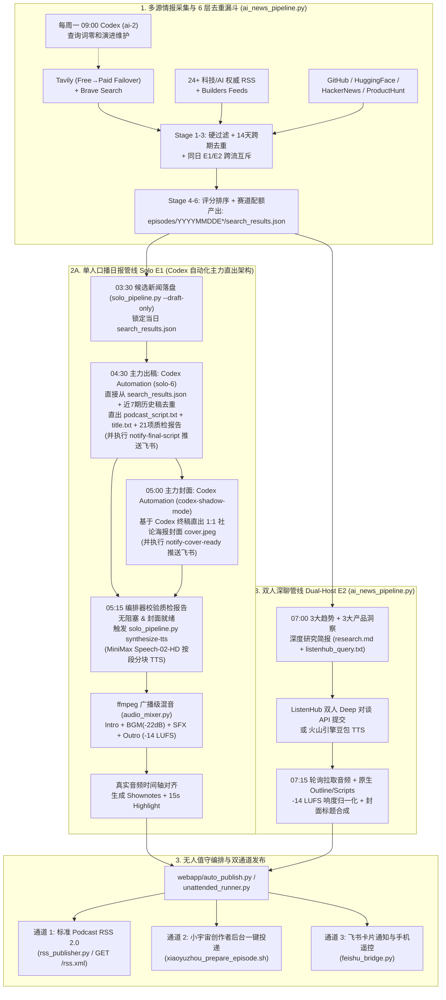

# 🎙️ AIGC Unattended Podcast Studio（AIGC 无人值守播客工作流）

[中文文档](./README.md) | [English README](./README_EN.md) | [开源提示词库 (`prompts/`)](./prompts/README.md) | [Codex 自动化任务 (`automations/`)](./automations/)

一套开箱即用、经过真实日更验证的 **AIGC 全自动无人值守播客生产与发布系统**。支持 **「单人口播晨间日报（Solo E1）」** 与 **「双人深聊趋势观察（Dual-Host E2）」** 双管线并行：由 **Python 6 层漏斗**完成全网一手 AI/科技信源抓取与去重，由 **Codex 定时自动化任务（`solo-6` + `codex-shadow-mode`）作为主力引擎直接从 `search_results.json` 直出总编级口播终稿、21 项质检报告与 1:1 社论海报封面**，再由下游编排器全自动触发分块 TTS、广播级动态压限混音（`-14 LUFS`）、真实音频时间轴对齐，最终完成 **标准 Podcast RSS 2.0 订阅源发布** 与 **小宇宙创作者后台一键投递**。

---

## ✨ 核心特性

- **🔎 8 大信源 × 6 层去重选品漏斗（`ai_news_pipeline.py`）**：
  - 聚合 **Tavily Search**（支持免费/付费双 Key 自动故障切换）、**Brave Search**、**24+ 权威科技/学术 RSS**（OpenAI、MIT Tech Review、TechCrunch、The Verge、Simon Willison、Latent Space 等）、**Hacker News Algolia**、**GitHub Trending / 高星新秀**、**Hugging Face Hub 热门模型**、**Product Hunt**。
  - 内置 6 层漏斗：硬规则噪音过滤 → 近 14 天跨期实体/事件去重（`.coverage_index.json`） → 同日跨流去重（同日单口与双人绝不撞题） → 相关性与信源权重评分 → 多样性赛道配额 → **Codex 周维护任务（`ai-2`）零和查询词演进**。
- **🧠 Codex 自动化主力直出引擎（单口 E1） + 双人深聊引擎（Dual-Host E2）**：
  - **单人口播晨间日报（Solo E1 —— Codex 主力直出架构）**：
    - **告别传统 Qwen/DeepSeek 初稿拼接**：前置 Python 脚本仅负责产出干净的候选池 `search_results.json`；**真正的出稿主力是 04:30 运行的 Codex 自动化任务（`solo-6`）**，它直接读取 `search_results.json` 与近 7 期历史稿，严格执行 **5 大开场范式轮换、四步口播法（事实 → 口径边界 → 主播判断 → 影响落点）、反 AI 腔句式频次硬约束、冲突动词标题**，一步直出 `podcast_script.txt`、`title.txt` 与 **21 项自检报告 `script_quality_report.md`**，并推送到飞书审稿。
    - **05:00 Codex 社论海报封面直出（`codex-shadow-mode`）**：读取 Codex 终稿，自动抽取当日总主题、中心问题、3–6 个冲突阵营公司名与关键词，直接生成 1:1 商业杂志社论海报风「图文一体」封面 `cover.jpeg`（无需本地二次叠字）。
    - *注：若运行环境未安装 Codex，系统也保留了 `--script-engine python`（内置 DeepSeek/Qwen/Gemini 降级链）作为纯 Python 备选兜底。*
  - **双人深聊趋势观察（Dual-Host E2）**：自动提炼「3 大产业趋势 + 3 大产品洞察」深度研究简报，支持 **ListenHub 双人深度对谈 API** 或 **火山引擎豆包语音（Volcengine TTS）** 合成。
- **🎚️ 广播级音频后期与真实时间轴对齐**：
  - **MiniMax `speech-02-hd` 分段合成**：按自然段切片合成，记录精确到毫秒的段落起止时间窗。
  - **`ffmpeg` 动态混音（`audio_mixer.py`）**：片头 Jingle（3.5s 全音量 → 淡入人声）+ 正文人声下垫 `-22 dB` 环境 BGM + 段落间转场音效（SFX）+ 片尾 Jingle 淡出 + 全片 **EBU R128 `-14 LUFS` / `-1 dBTP`** 响度归一化 + 15 秒高光预览切片（`highlight_15s.mp3`）。
  - **真实音频时间轴（Shownotes）**：拒绝按字数估算的假时间轴，支持基于分块真实时长或 **Qwen3-ASR / Whisper** 语音识别反推每条新闻精确时间戳。
- **📡 双通道发布（标准 RSS 2.0 + 小宇宙一键投递）**：
  - **标准 Podcast RSS 2.0（开箱即用）**：内置 `rss_publisher.py` 与 FastAPI 动态路由（`/rss.xml`、`/rss/solo.xml`、`/rss/dual_host.xml`），兼容 Apple Podcasts、Spotify、Overcast、Pocket Casts 及各类泛用型播客客户端。
  - **小宇宙创作者后台自动投递**：支持音频/封面直传小宇宙 COS、HTML Shownotes 排版校验、定时发布与会话自愈刷新。
- **📱 Web 管理控制台与飞书移动端遥控**：
  - 内置 FastAPI 暗色玻璃拟态 Web 控制台（`http://localhost:8765`），支持在线试听、单集管理、实时 SSE 日志流、可视化修改定时任务。
  - 支持飞书机器人卡片推送与手机端指令遥控（如发送 `状态`、`合成TTS`、`确认发布小宇宙`）。

---

## 🏗️ 系统架构与全链路流程图



---

## 🚀 5 分钟快速开始（Quick Start）

### 1. 环境准备

确保系统已安装 **Python 3.10+** 与 **`ffmpeg`**（用于音频混音与响度归一化），推荐使用 **Codex Desktop / CLI** 运行主力写稿与生图自动化任务：

```bash
# macOS (Homebrew)
brew install ffmpeg python

# Ubuntu / Debian
sudo apt-get update && sudo apt-get install -y ffmpeg python3-pip

# 安装 Python 依赖
pip install -r requirements.txt
```

### 2. 配置 API Key（`.env`）

复制环境变量模板并填入你自己的新闻抓取、TTS 与（可选）备用 LLM Key：

```bash
cp .env.example .env
```

核心配置项说明（详见 [`.env.example`](./.env.example)）：

| 类别 | 环境变量 | 用途说明 |
| :--- | :--- | :--- |
| **新闻抓取** | `TAVILY_API_KEY` | 主力 AI/科技新闻检索（支持配置 `TAVILY_API_KEY_PAID` 自动故障切换） |
| **新闻抓取（可选）** | `BRAVE_SEARCH_API_KEY` | 补充检索与分类回填（未配置时自动使用 Tavily + RSS + 社区源） |
| **单口主力出稿 & 封面 (E1)** | **Codex Automation (`solo-6` + `codex-shadow-mode`)** | 详见 [`automations/`](./automations/) 与 [`prompts/`](./prompts/README.md)，直接从 `search_results.json` 直出终稿与 1:1 社论海报封面 |
| **单口 TTS (E1)** | `MINIMAX_API_KEY` | MiniMax `speech-02-hd` 新闻主播音色合成 |
| **双人研报 & 备选 LLM** | `DEEPSEEK_API_KEY` / `QWEN_API_KEY` / `GEMINI_API_KEY` | 用于双人深聊（E2）研究简报生成，或无 Codex 环境下的 `--script-engine python` 备选兜底 |
| **双人 TTS (E2)** | `LISTENHUB_API_KEY` 或 `VOLC_TTS_*` | ListenHub 双人深度对谈 API 或 火山引擎豆包语音 TTS |
| **发布与订阅** | `PODCAST_BASE_URL` / `XIAOYUZHOU_PODCAST_PID` | RSS 2.0 外部访问域名 / 小宇宙播客 PID（按需配置） |

### 3. 运行无人值守工作流（兩種方式）

#### 方式一：生产级推荐 —— Codex Automation 定时协同流水线（与作者同款日更架构）

将 [`automations/`](./automations/) 下的 3 个 TOML 配置导入你的 `~/.codex/automations/`（将 `cwds` 改为你的本地仓库路径），配合系统定时任务与 `webapp/auto_publish.py` 编排器即可全自动运行：

| 时间点 | 执行组件 | 核心动作与产物 |
| :--- | :--- | :--- |
| **03:30** | `./run_solo_podcast_daily.sh` | 抓取 8 大信源并过 6 层漏斗，产出 `episodes/YYYYMMDDE1/search_results.json` |
| **04:30** | **Codex `solo-6`** ([`solo_6_codex_script.toml`](./automations/solo_6_codex_script.toml)) | **主力出稿**：从 `search_results.json` 直出 `podcast_script.txt` + `title.txt` + `script_quality_report.md`，并调用 `notify-final-script` 推送飞书 |
| **05:00** | **Codex `codex-shadow-mode`** ([`codex_shadow_mode_cover.toml`](./automations/codex_shadow_mode_cover.toml)) | **主力封面**：基于 Codex 终稿直出 1:1 社论海报封面 `cover.jpeg`，并调用 `notify-cover-ready` 推送飞书 |
| **05:15** | `webapp/auto_publish.py` | 检测到 `script_quality_report.md` 无阻塞且 `cover.jpeg` 就绪后，自动执行 `solo_pipeline.py synthesize-tts` 合成音频并投递小宇宙 / 更新 RSS |
| **每周一 09:00** | **Codex `ai-2`** ([`ai_2_query_zero_sum.toml`](./automations/ai_2_query_zero_sum.toml)) | **查询词零和维护**：纳新近 30 天新出现的 AI 独角兽与热门产品，淘汰过时词条，锁死每日 API Credits 恒定 |

#### 方式二：CLI 一键串行跑批入口（`unattended_runner.py`）

你也可以直接用 [`unattended_runner.py`](./unattended_runner.py) 一条命令串行驱动「抓新闻 → Codex 直出终稿与封面 → MiniMax TTS 与混音 → 发布 RSS / 小宇宙」：

```bash
# 1. 先用 Dry-Run 验证配置与执行计划（不消耗 TTS 额度、不外发）
python3 unattended_runner.py --flow solo --dry-run

# 2. 一键跑完「单人口播日报 (E1)」全流程（默认使用 Codex 引擎从 JSON 直出稿件与封面）+ 生成标准 Podcast RSS 2.0
python3 unattended_runner.py --flow solo --script-engine codex --publish-rss --base-url https://your-podcast-domain.com

# 3. 备选：如果当前机器未安装 Codex CLI，可切换为内置 Python LLM 链兜底
python3 unattended_runner.py --flow solo --script-engine python --cover-provider gemini --publish-rss

# 4. 一键跑完「双人深聊 (E2)」全流程 + 更新 RSS
python3 unattended_runner.py --flow dual_host --audio-mode listenhub --poll-listenhub --publish-rss

# 5. 生成完成后同时自动投递到「小宇宙创作者后台」+ 更新 RSS
python3 unattended_runner.py --flow solo --publish-rss --publish-xiaoyuzhou
```

### 4. 启动 Web 控制台与动态 RSS 2.0 服务

```bash
./start_webapp.sh
```

启动后访问：
- **播客公开主页与在线试听**：`http://localhost:8765/episodes`
- **标准 Podcast RSS 2.0 订阅地址**：
  - 全量节目源：`http://localhost:8765/rss.xml`（或 `/feed.xml`）
  - 仅单口日报（E1）：`http://localhost:8765/rss/solo.xml`
  - 仅双人深聊（E2）：`http://localhost:8765/rss/dual_host.xml`
- **管理后台（流水线触发 / 实时日志 / 定时调度）**：`http://localhost:8765/admin`（默认密码见 `.env` 中的 `WEBAPP_ADMIN_PASSWORD`）

---

## 📡 发布通道详解：RSS 2.0 订阅 & 小宇宙一键投递

### 通道一：标准 Podcast RSS 2.0 发布（推荐通用方案）

无论你是否使用小宇宙，都可以通过标准 RSS 2.0 将播客分发到 **Apple Podcasts、Spotify、Pocket Casts、Overcast、小宇宙（支持 RSS 导入托管）** 等任意平台：

1. **动态 RSS 服务**：运行 `./start_webapp.sh`，结合 Cloudflare Tunnel / Nginx 反代将 `http://localhost:8765` 暴露为公网 HTTPS 域名，在 `.env` 中设置 `PODCAST_BASE_URL="https://podcast.yourdomain.com"`，即可直接使用 `https://podcast.yourdomain.com/rss.xml` 作为播客 RSS 地址。
2. **静态 RSS 生成**：也可使用 [`rss_publisher.py`](./rss_publisher.py) 生成静态 `rss.xml` 配合对象存储（S3 / Cloudflare R2 / GitHub Pages）托管：
   ```bash
   python3 rss_publisher.py --base-url https://podcast.yourdomain.com --output ./rss.xml
   ```

### 通道二：小宇宙创作者后台自动投递

如果你在小宇宙创作者平台（`podcaster.xiaoyuzhoufm.com`）维护节目：
1. 在 `.env` 中配置你的 24 位播客 ID：`XIAOYUZHOU_PODCAST_PID="你的小宇宙PID"`。
2. 在本机 Chrome 登录一次小宇宙创作者后台（登录态仅保存在本地被 Git 忽略的 `.xiaoyuzhou_auth.json` 中，绝不入库）。
3. 执行单集一键上传与定时发布：
   ```bash
   # 先用 DRY_RUN 预览标题、Shownotes HTML 与排期时间
   DRY_RUN=true ./xiaoyuzhou_prepare_episode.sh ./episodes/20260501E1

   # 正式上传音频、封面并创建定时单集
   ./xiaoyuzhou_prepare_episode.sh ./episodes/20260501E1
   ```

---

## 📝 开源提示词库与 Codex 自动化任务（Prompts & Automations）

我们将全套经过上百期实战打磨的 **Codex 生产提示词、定时任务 TOML 配置与 21 项质检脚本**完整开源：

1. **[`prompts/solo_daily_script_prompt.md`](./prompts/solo_daily_script_prompt.md)**（对应 [`automations/solo_6_codex_script.toml`](./automations/solo_6_codex_script.toml)）：
   - **直接从 `search_results.json` 组装终稿**（不依赖 Python 初稿或 `research.md`）；
   - **P0–P3 四级事件选品规则**与近 7 期「同主体 × 同事件」严格去重；
   - **5 大开场范式强制轮换**（提问开场 / 单个画面开场 / 时间锚开场 / 反差开场 / 一句结论开场），杜绝套话模板；
   - **四步口播结构**：先交代事实 → 再交代口径边界 → 再给主播判断 → 最后落到具体受影响对象；
   - **21 项自检清单**，输出 `script_quality_report.md` 并配套确定性校验脚本 [`scripts/check_solo_v2_script.py`](./scripts/check_solo_v2_script.py)。
2. **[`prompts/solo_editorial_cover_prompt.md`](./prompts/solo_editorial_cover_prompt.md)**（对应 [`automations/codex_shadow_mode_cover.toml`](./automations/codex_shadow_mode_cover.toml)）：
   - 单口播客 1:1 讽刺社论杂志风「图文一体」封面生成提示词，图内直接嵌有可读中文大字、冲突阵营公司名与视觉隐喻。
3. **[`prompts/query_zero_sum_maintenance_prompt.md`](./prompts/query_zero_sum_maintenance_prompt.md)**（对应 [`automations/ai_2_query_zero_sum.toml`](./automations/ai_2_query_zero_sum.toml)）：
   - 新闻搜索词每周「零和恒定」维护提示词（在不增加 API 调用配额的前提下动态纳新、淘汰过时实体）。

---

## 📂 目录结构说明

```text
.
├── unattended_runner.py          # 一键无人值守总入口（默认驱动 Codex 从 JSON 直出稿件与封面 -> TTS 混音 -> RSS/小宇宙）
├── rss_publisher.py              # 标准 Podcast RSS 2.0 订阅源生成器（CLI + FastAPI 动态挂载）
├── automations/                  # 生产主力 Codex 定时自动化任务配置模板（solo-6 直出终稿 / 社论封面 / 查询词零和维护）
├── prompts/                      # 开源提示词库（单口主笔 21 项质检、社论海报封面、查询词零和维护）
├── solo_pipeline.py              # 单人口播（E1）新闻候选池采集、TTS 混音合成（synthesize-tts）与飞书通知入口
├── solo_pipeline_modular/        # 单人口播模块化核心（新闻选品 / 真实时间轴 Shownotes / 发布 / Python 备选写稿链）
├── ai_news_pipeline.py           # 多源新闻采集 6 层漏斗 + 双人深聊（E2）主入口
├── minimax_tts.py                # MiniMax Speech-02-HD 分块 TTS 合成与毫秒级时长追踪
├── audio_mixer.py                # ffmpeg 广播级动态混音器（片头/片尾 + BGM 闪避 + 转场音效 + -14 LUFS 归一化）
├── compose_cover_title.py        # 双人播客封面中文标题排版合成器
├── xiaoyuzhou_publish_pipeline.py# 小宇宙创作者后台上传、Shownotes 校验与定时发布管线
├── xiaoyuzhou_prepare_episode.sh # 小宇宙单集发布 Shell 包装器（支持 DRY_RUN 与 Token 自动刷新）
├── feishu_bridge.py              # 飞书长连接机器人桥接器（支持手机端指令控制与进度通知）
├── webapp/                       # FastAPI Web 播客主页、管理控制台、SSE 日志流与 auto_publish 守护循环
├── scripts/                      # 质量门禁脚本（check_solo_v2_script.py、每日新闻复盘、竞品雷达）
├── tools/                        # 竞品选题雷达（competitor_radar）与单口新闻复盘工具（solo_review）
├── audio_assets/                 # 免版税片头/片尾 Jingle、环境 BGM 与段落转场音效（SFX）
├── news_pipeline_rules.json      # 新闻抓取查询模板、域名可信度权重与过滤规则配置
├── rss_feeds.json                # 24+ 国内外权威科技/AI/学术 RSS 订阅源清单
├── schedule_config.json          # 自动化排期与无人值守时间窗配置
├── .env.example                  # 环境变量配置模板（零私钥泄露）
└── requirements.txt              # Python 依赖清单
```

---

## 🔒 安全与隐私设计（Security by Default）

- **零密钥硬编码**：所有 API Key、飞书凭证、小宇宙 `PODCAST_PID` 均通过环境变量（`.env`）注入。
- **登录态严格隔离**：`.gitignore` 默认拦截所有 `.env*`、`*_auth.json*`、`.xiaoyuzhou_auth.json*` 及本地数据库文件，确保个人账号会话与 Cookie 绝不会被意外提交。
- **发布幂等与故障熔断**：当 Codex 质检报告（`script_quality_report.md`）标记候选新闻不足 6 条或存在阻塞项时，`webapp/auto_publish.py` 自动熔断拦截，绝不合成残次音频或误发上线。

---

## 🧪 运行测试

```bash
pytest -q
```

## 📄 License

[MIT License](./LICENSE). 欢迎自由复刻、改装属于你自己的垂直领域 AIGC 无人值守播客电台！
