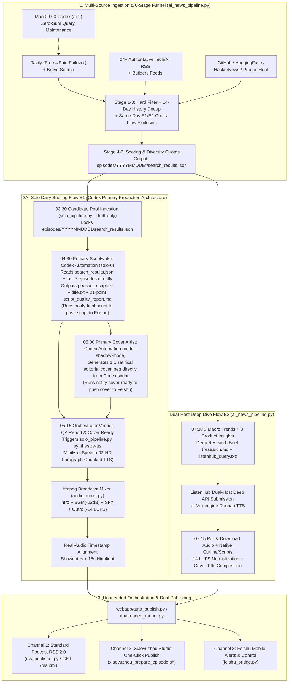

# 🎙️ AIGC Unattended Podcast Studio

[中文文档](./README.md) | [English README](./README_EN.md) | [Open-Source Prompts (`prompts/`)](./prompts/README.md) | [Codex Automations (`automations/`)](./automations/)

An out-of-the-box, production-tested **AIGC Unattended Podcast Production & Publishing Workflow**. It runs two complementary podcast formats in parallel — **Solo Daily Briefing (`E1`)** and **Dual-Host Deep Dive (`E2`)** — combining a deterministic **Python 6-stage news deduplication funnel** with **Codex Scheduled Automations (`solo-6` + `codex-shadow-mode`) as the primary scriptwriting & cover generation engine** (writing final broadcast scripts, 21-point QA reports, and 1:1 satirical editorial covers directly from `search_results.json`), followed by chunked TTS synthesis, broadcast-grade `ffmpeg` mixing (`-14 LUFS`), real-audio timestamp alignment, **Standard Podcast RSS 2.0 publishing**, and **one-click Xiaoyuzhou Podcaster Studio delivery**.

---

## ✨ Key Features

- **🔎 8 News Sources × 6-Stage Deduplication Funnel (`ai_news_pipeline.py`)**:
  - Aggregates **Tavily Search** (with automatic Free → Paid API key failover), **Brave Search**, **24+ authoritative AI/tech RSS feeds** (OpenAI, MIT Tech Review, TechCrunch, The Verge, Simon Willison, Latent Space, etc.), **Hacker News Algolia**, **GitHub Trending / Fast-Growing Repos**, **Hugging Face Hub Trending Models**, and **Product Hunt**.
  - 6-Stage Funnel: Hard noise filtering → 14-day cross-episode entity/event deduplication (`.coverage_index.json`) → Same-day cross-flow exclusion (`E1` and `E2` never repeat the same story) → Relevance & source-tier scoring → Category diversity quotas → **Weekly zero-sum query evolution via Codex Automation (`ai-2`)**.
- **🧠 Codex-Native Primary Script & Cover Engine (`Solo E1`) + Dual-Host Engine (`E2`)**:
  - **Solo Daily Briefing (`E1` — Codex Direct-from-JSON Architecture)**:
    - **Why Codex instead of a naive Python Qwen/DeepSeek draft chain?** Early multi-step LLM chains in Python suffered from repetitive AI phrasing, template fatigue, and subtle cross-episode duplication. In production, the 03:30 Python job (`solo_pipeline.py --draft-only`) is used solely to output the filtered candidate pool `search_results.json`.
    - **04:30 Primary Scriptwriter (`Codex Automation: solo-6`)**: Reads `search_results.json` and the last 7 episodes' `podcast_script.txt` directly (ignoring legacy Python drafts), enforces **5 rotating opening paradigms, a 4-step storytelling structure (Fact → Scope Boundary → Host Judgment → Concrete Impact), anti-cliché frequency caps, and conflict-verb headlines**, and directly outputs `podcast_script.txt`, `title.txt`, and the **21-point quality report (`script_quality_report.md`)** before pushing the final script to Feishu for mobile review.
    - **05:00 Primary Cover Designer (`Codex Automation: codex-shadow-mode`)**: Reads the Codex-written script, extracts the core theme, central question, 3–6 competing companies, and Chinese keywords, and generates a 1:1 satirical editorial magazine cover (`cover.jpeg`) with embedded typography directly (no local text overlay needed).
    - *Note: For environments without Codex installed, `--script-engine python` (DeepSeek → Qwen → Gemini chain) remains available as a standalone fallback.*
  - **Dual-Host Deep Dive (`E2`)**: Synthesizes a structured *"3 Macro Trends + 3 Product Insights"* deep research brief (`research.md`) and generates natural two-host dialogue via **ListenHub Deep Mode API** or **Volcengine (Doubao) TTS**.
- **🎚️ Broadcast-Grade Audio Mixing & Real-Audio Timestamp Alignment**:
  - **MiniMax `speech-02-hd` Chunked TTS**: Synthesizes scripts paragraph-by-paragraph while tracking exact millisecond boundaries.
  - **`ffmpeg` Dynamic Audio Mixer (`audio_mixer.py`)**: Full-volume intro jingle (3.5s) → smooth crossfade into voice with `-22 dB` ambient BGM bed → inter-story transition SFX → outro jingle fade-in → **EBU R128 `-14 LUFS` / `-1 dBTP`** loudness normalization → 15-second highlight clip extraction (`highlight_15s.mp3`).
  - **Real-Audio Shownotes Timestamps**: Computes accurate `[MM:SS]` chapter timestamps from real synthesized audio chunks or **Qwen3-ASR / Whisper** transcription rather than character-count heuristics.
- **📡 Dual Publishing Channels (Standard Podcast RSS 2.0 + Xiaoyuzhou Studio)**:
  - **Standard Podcast RSS 2.0 (Out of the Box)**: Built-in `rss_publisher.py` CLI and dynamic FastAPI endpoints (`/rss.xml`, `/rss/solo.xml`, `/rss/dual_host.xml`) compatible with Apple Podcasts, Spotify, Overcast, Pocket Casts, and any RSS podcast player.
  - **Xiaoyuzhou Podcaster Studio Automation**: Direct audio/cover upload, HTML shownotes preflight validation, scheduled publishing, and automatic browser session refresh.
- **📱 Web Admin Console & Feishu/Lark Mobile Remote Control**:
  - Dark glassmorphism FastAPI web dashboard (`http://localhost:8765`) for episode browsing, live SSE pipeline logs, and visual schedule management.
  - Optional Feishu bot integration for mobile push notifications and interactive chat commands (`状态`, `合成TTS`, `确认发布小宇宙`).

---

## 🏗️ System Architecture



---

## 🚀 5-Minute Quick Start

### 1. Prerequisites

Install **Python 3.10+** and **`ffmpeg`** (required for audio mixing and loudness normalization), plus **Codex Desktop / CLI** for the primary Solo E1 scriptwriting and cover automations:

```bash
# macOS (Homebrew)
brew install ffmpeg python

# Ubuntu / Debian
sudo apt-get update && sudo apt-get install -y ffmpeg python3-pip

# Install Python dependencies
pip install -r requirements.txt
```

### 2. Configure API Keys (`.env`)

Copy the environment template and fill in your API keys:

```bash
cp .env.example .env
```

Core environment variables (see [`.env.example`](./.env.example) for full list):

| Category | Variable | Description |
| :--- | :--- | :--- |
| **News Search** | `TAVILY_API_KEY` | Primary AI/tech news search (supports `TAVILY_API_KEY_PAID` for auto-failover) |
| **News Search (Optional)** | `BRAVE_SEARCH_API_KEY` | Secondary search & category backfill (falls back to Tavily + RSS + community feeds if omitted) |
| **Solo Primary Script & Cover (`E1`)** | **Codex Automations (`solo-6` + `codex-shadow-mode`)** | See [`automations/`](./automations/) & [`prompts/`](./prompts/README.md); writes final scripts & 1:1 editorial covers directly from `search_results.json` |
| **Solo TTS (`E1`)** | `MINIMAX_API_KEY` | MiniMax `speech-02-hd` news anchor voice synthesis |
| **Dual-Host Research & Fallback LLMs** | `DEEPSEEK_API_KEY` / `QWEN_API_KEY` / `GEMINI_API_KEY` | Used for Dual-Host (`E2`) deep research briefs, or `--script-engine python` fallback when Codex is unavailable |
| **Dual-Host TTS (`E2`)** | `LISTENHUB_API_KEY` or `VOLC_TTS_*` | ListenHub Dual-Host Deep API or Volcengine Doubao TTS |
| **Publishing** | `PODCAST_BASE_URL` / `XIAOYUZHOU_PODCAST_PID` | Public base URL for RSS 2.0 feed / Xiaoyuzhou 24-hex Podcast ID |

### 3. Run the Unattended Workflow (Two Modes)

#### Mode A: Production Recommended — Codex Scheduled Automations + Orchestrator

Import the 3 TOML templates in [`automations/`](./automations/) into `~/.codex/automations/` (update `cwds` to your local repo path):

| Time (CST) | Component | Action & Output |
| :--- | :--- | :--- |
| **03:30** | `./run_solo_podcast_daily.sh` | Runs the 8-source 6-stage funnel to produce `episodes/YYYYMMDDE1/search_results.json` |
| **04:30** | **Codex `solo-6`** ([`solo_6_codex_script.toml`](./automations/solo_6_codex_script.toml)) | **Primary Scriptwriter**: Writes `podcast_script.txt` + `title.txt` + `script_quality_report.md` directly from `search_results.json` and pushes to Feishu |
| **05:00** | **Codex `codex-shadow-mode`** ([`codex_shadow_mode_cover.toml`](./automations/codex_shadow_mode_cover.toml)) | **Primary Cover Artist**: Generates 1:1 editorial cover `cover.jpeg` directly from the Codex script and pushes to Feishu |
| **05:15** | `webapp/auto_publish.py` | Verifies `script_quality_report.md` & `cover.jpeg` are ready, runs `solo_pipeline.py synthesize-tts`, and publishes to Xiaoyuzhou / RSS |
| **Mon 09:00** | **Codex `ai-2`** ([`ai_2_query_zero_sum.toml`](./automations/ai_2_query_zero_sum.toml)) | **Zero-Sum Query Maintenance**: Adds emerging AI entities while retiring stale ones to keep daily search API credit consumption constant |

#### Mode B: One-Click CLI Runner (`unattended_runner.py`)

Run [`unattended_runner.py`](./unattended_runner.py) directly from the command line or `crontab`:

```bash
# Option A: Dry-run to verify configuration and planned steps without spending TTS credits
python3 unattended_runner.py --flow solo --dry-run

# Option B: Full end-to-end Solo Daily Briefing (E1) using Codex primary engine + Standard Podcast RSS 2.0
python3 unattended_runner.py --flow solo --script-engine codex --publish-rss --base-url https://your-podcast-domain.com

# Option C: Standalone Python LLM fallback (if Codex CLI is not installed on the host)
python3 unattended_runner.py --flow solo --script-engine python --cover-provider gemini --publish-rss

# Option D: Full Dual-Host Deep Dive (E2) + RSS update
python3 unattended_runner.py --flow dual_host --audio-mode listenhub --poll-listenhub --publish-rss

# Option E: End-to-end Solo run + publish to both RSS 2.0 and Xiaoyuzhou Podcaster Studio
python3 unattended_runner.py --flow solo --publish-rss --publish-xiaoyuzhou
```

### 4. Start the Web Dashboard & Dynamic RSS 2.0 Server

```bash
./start_webapp.sh
```

Once running, open:
- **Public Podcast Website & Web Player**: `http://localhost:8765/episodes`
- **Standard Podcast RSS 2.0 Feeds**:
  - All Episodes: `http://localhost:8765/rss.xml` (or `/feed.xml`)
  - Solo Daily Briefing (`E1`) Only: `http://localhost:8765/rss/solo.xml`
  - Dual-Host Deep Dive (`E2`) Only: `http://localhost:8765/rss/dual_host.xml`
- **Admin Dashboard (Trigger Runs / Live SSE Logs / Schedule Config)**: `http://localhost:8765/admin` (password configured via `WEBAPP_ADMIN_PASSWORD` in `.env`)

---

## 📡 Publishing Channels: Podcast RSS 2.0 & Xiaoyuzhou Studio

### Channel 1: Standard Podcast RSS 2.0 (Universal)

Distribute your AI podcast to **Apple Podcasts, Spotify, Overcast, Pocket Casts, Castro**, or any RSS-compatible platform:

1. **Dynamic FastAPI RSS Endpoint**: Run `./start_webapp.sh` behind your domain (e.g., via Nginx or Cloudflare Tunnel), set `PODCAST_BASE_URL="https://podcast.yourdomain.com"` in `.env`, and subscribe to `https://podcast.yourdomain.com/rss.xml`.
2. **Static RSS File Generation**: Generate a static `rss.xml` file for S3 / Cloudflare R2 / GitHub Pages hosting:
   ```bash
   python3 rss_publisher.py --base-url https://podcast.yourdomain.com --output ./rss.xml
   ```

### Channel 2: One-Click Xiaoyuzhou Podcaster Studio Delivery

For creators publishing on **Xiaoyuzhou (`podcaster.xiaoyuzhoufm.com`)**:
1. Set `XIAOYUZHOU_PODCAST_PID="your_24_char_podcast_pid"` in `.env`.
2. Log in once to Xiaoyuzhou Podcaster Studio in Chrome on your macOS host (session tokens are cached locally in `.xiaoyuzhou_auth.json`, which is strictly git-ignored).
3. Run one-click upload and scheduled publishing:
   ```bash
   # Preview inputs, formatted HTML shownotes, and scheduled time without uploading
   DRY_RUN=true ./xiaoyuzhou_prepare_episode.sh ./episodes/20260501E1

   # Upload audio + cover and create/update the scheduled episode
   ./xiaoyuzhou_prepare_episode.sh ./episodes/20260501E1
   ```

---

## 📝 Open-Source Prompts & Codex Automations (`prompts/` & `automations/`)

All production prompts, Codex Automation TOML templates, and quality verification scripts are open-sourced:

1. **[`prompts/solo_daily_script_prompt.md`](./prompts/solo_daily_script_prompt.md)** (paired with [`automations/solo_6_codex_script.toml`](./automations/solo_6_codex_script.toml)):
   - **Writes the final broadcast script directly from `search_results.json`** (bypassing Python drafts and `research.md`);
   - **P0–P3 event priority hierarchy** & 7-episode *"Same Entity × Same Event"* deduplication;
   - **5 rotating opening paradigms** (Question / Single Scene / Time Anchor / Contrast / Direct Verdict) to eliminate repetitive AI clichés;
   - **4-step narrative per story**: Fact → Scope/Metric Boundary → Host Judgment → Concrete Affected Group;
   - **21-Point Self-Check Rubric**, paired with [`scripts/check_solo_v2_script.py`](./scripts/check_solo_v2_script.py).
2. **[`prompts/solo_editorial_cover_prompt.md`](./prompts/solo_editorial_cover_prompt.md)** (paired with [`automations/codex_shadow_mode_cover.toml`](./automations/codex_shadow_mode_cover.toml)):
   - 1:1 satirical editorial magazine cover generation prompt with embedded Chinese typography and camp contrast.
3. **[`prompts/query_zero_sum_maintenance_prompt.md`](./prompts/query_zero_sum_maintenance_prompt.md)** (paired with [`automations/ai_2_query_zero_sum.toml`](./automations/ai_2_query_zero_sum.toml)):
   - Weekly zero-sum search query maintenance prompt (adds emerging AI entities while retiring stale ones to keep Tavily/Brave API credit usage constant).

---

## 🔒 Security & Privacy by Default

- **Zero Hardcoded Secrets**: All API keys, Feishu credentials, and `XIAOYUZHOU_PODCAST_PID` are loaded exclusively from environment variables (`.env`).
- **Session Isolation**: `.gitignore` blocks all `.env*`, `*_auth.json*`, `.xiaoyuzhou_auth.json*`, and local SQLite databases so login cookies and tokens are never committed.
- **Fail-Safe Quality Circuit Breaker**: If fewer than 6 qualified news stories are found or the Codex script quality report flags a blocker, downstream TTS and publishing automatically halt.

---

## 🧪 Running Tests

```bash
pytest -q
```

## 📄 License

[MIT License](./LICENSE). Feel free to fork, customize, and launch your own unattended AI podcast station!
